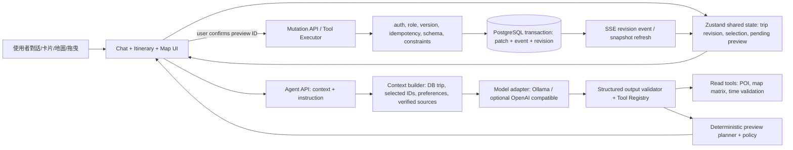

# AIYO AI-Native Travel Planner：架構分析與開發計畫

> 2026-11-04 現況盤點。本文只規劃，不代表功能已實作；本輪未修改既有程式、安裝套件或執行 migration。實作時遵守 `AGENTS.md` 的真實 POI、偏好重用、失敗降級與測試規則。

## 1. 現況與缺口

| 範圍 | 已有實作與位置 | 升級時需處理 |
|---|---|---|
| 基礎 | Next.js 16 App Router、React 19、TypeScript、Zod 4、Prisma 6/PostgreSQL；`package.json` | 沿用，不重建應用 |
| AI | `src/app/api/ai/chat/route.ts`、`src/app/api/trip/revise/route.ts`、`src/server/services/travelPlannerService.ts`、`src/server/ai/travelAgentOrchestrator.ts`；Ollama/Open WebUI、本地模型、JSON 解析與研究工具 | 現有修訂偏向生成回覆/全行程，尚無伺服端細粒度行程 mutation executor；先建立受控 patch 通道 |
| 現有動作 | `src/lib/assistantActions/`、`src/app/chat/page.tsx` 的 `applyAiProposedChanges` 與 `applyItineraryUpdateFromResponse` | 客戶端直接操作 Zustand 的路徑需逐步導向服務端確認套用；保留舊流程作相容與回退 |
| 資料與權限 | `prisma/schema.prisma` 的 Trip/TripDay/TripItem/MapPin/ChatMessage/TripCollaborator；`src/server/data/appStateService.ts`、`src/server/tripAccess.ts` | `saveTripPayload` 在交易中刪除重建 days/items/pins；細粒度編輯需保留 ID、版本與原子性；權限在每次寫入重新檢查 |
| 前端狀態 | `src/stores/useTripStore.ts`、`useMapStore.ts`、`useChatStore.ts`、`useCollabStore.ts`；`src/services/syncService.ts` 協調快照、地圖與 SSE | 建立 trip-scoped 選取狀態與 patch revision；避免 AI 回覆與本地自動儲存競寫 |
| 行程/地圖 | `src/app/itinerary/page.tsx` 已可編輯及拖曳；`src/services/mapSync.ts`；MapLibre 與 `src/server/maps/` 的搜尋/路線/矩陣 | 沿用卡片與地圖資料；地圖選取轉為明確的上下文引用；確認後統一刷新時間軸與 pins |
| 影片/RAG | `src/server/video/` 抽取逐字稿、片段及已驗證地點；`VideoSummaryCache`、`VideoInteraction`、`AppliedVideoSummary`；`src/server/memory/` mem0 回憶與 `aiContextBuilder`；`src/server/search/` 網路研究 | 目前是影片語意抽取、摘要快取、記憶檢索與研究拼接；schema 未見獨立向量欄位/向量索引。不得假定已有向量 RAG；先以來源證據的短摘要供 agent 檢索 |
| 協作/串流 | `src/app/api/realtime/stream/route.ts` 定期推送 bootstrap 快照；`src/services/syncService.ts` 用 EventSource；`src/app/api/chat/stream/[sessionId]/route.ts` 為對話進度；協作 room、presence、comments | 目前同步偏快照輪詢式 SSE，缺少持久化 mutation revision、衝突判斷與 patch event；進度串流不能當提交成功依據 |

風險基線：`Trip.updatedAt` 可作粗略偵測，但不足以防止並行寫入；`saveTripPayload` 重建子列會使既有 item ID 失效。任何新 API 都必須與既有整份儲存流程協調，否則 AI 修改可能被舊快照覆蓋。`/api/trip/revise` 對登入/記憶查詢的 catch 會繼續修訂生成，不能作為授權寫入入口。模型目前透過 `ollamaClient.ts` 使用 Ollama `/api/chat` 及 JSON/串流內容；LM Studio／llama.cpp 的 OpenAI-compatible tool calling 尚未在專案驗證。

## 2. 目標架構與資料流



核心規則：模型只輸出意圖與候選工具參數；伺服端工具註冊表只允許白名單、Zod/JSON Schema 驗證、資料庫權限與商業約束。模型不得直接執行程式碼、操作 DOM、指定 SQL 或取得可任意呼叫的寫入憑證。前端 renderer 只解析受控元件 schema，不渲染模型提供的 HTML/JS。

### 一次「第二天下午改室內」的流程

1. UI 傳 `tripId`、`baseRevision`、自然語言及 `selectedEntityIds`（均只作提示）；伺服端依登入者重讀行程、授權及 ID 所屬，避免信任客戶端內容。
2. Agent 解析第二天午後項目，使用已驗證 POI/搜尋與路線矩陣，檢查營業時間、停留與交通緩衝；資料不足時產生少量候選與警告。
3. 伺服端建立帶 TTL 的 preview：逐項 before/after、交通與時間差、來源、影響的 pins；UI 互動卡片讓使用者換候選/時間並重新驗證。
4. 使用者確認時提交 `previewId + baseRevision + idempotencyKey`。executor 重新驗證權限、版本、候選有效期及約束，在單一交易中寫入 items、pins、revision、mutation event。
5. 回傳標準 trip snapshot/patch；`syncService` 原子更新 `useTripStore` 與 `useMapStore`，SSE 通知其他端重抓。失敗不改動顯示的已確認資料；衝突回傳 409 和最新快照供重算。

## 3. 介面、資料模型與安全契約

**新增資料（建議 migration 在實作階段才做）**：`Trip.revision Int @default(0)`；`TripMutation` (`id`, `tripId`, `actorId`, `baseRevision`, `resultRevision`, `idempotencyKey`, `operationsJson`, `inverseJson`, `source`, `createdAt`；唯一 `(tripId,idempotencyKey)`、`(tripId,resultRevision)`)，`AgentPreview` (`id`, `tripId`, `actorId`, `baseRevision`, `proposalJson`, `expiresAt`, `status`, `createdAt`)。Preview 可先存在 DB 以跨程序/重啟可確認；不要只存進程記憶體。事件紀錄限制保留量及敏感資料，逆操作僅含允許復原的行程欄位。可選 `TripItem` 唯一 `(tripId, day, order)` 需先清理既有資料並評估重排交易策略；`MapPin.linkedTripItemId` 現為字串而非 FK，新增驗證或後續遷移 FK。

**API（新增，不改既有回應契約）**：

| 路由 | 請求/回應 | 驗證 |
|---|---|---|
| `POST /api/trips/[id]/agent/preview` | `{instruction, baseRevision, selectedEntityIds?, uiContext?}` → `{previewId, expiresAt, baseRevision, summary, operations, warnings, ui}` | 登入、view/edit 權限；限制訊息與上下文長度；讀取工具有超時 |
| `POST /api/trips/[id]/agent/preview/[previewId]/apply` | `{baseRevision,idempotencyKey}` → `{revision, trip, mutationId}` | 必須 editor/owner、preview 作者與 trip 相符、未過期、版本相符；交易內再次驗證 |
| `POST /api/trips/[id]/mutations/[mutationId]/undo` | `{baseRevision,idempotencyKey}` → 同上 | 僅允許可逆操作；以新的 mutation 寫入，不直接倒退 revision |
| `POST /api/trips/[id]/mutations/[mutationId]/redo` | 同上 | 重放前再檢查前置條件、權限和版本 |
| `GET /api/trips/[id]/events?afterRevision=n` | revision events；超出保留期回 snapshot | view 權限；多人 SSE 可沿既有 realtime route 擴充 |

**操作 schema 範例**（`additionalProperties: false`；數量、字串長度、日期時間範圍均設上限）：

```ts
const Operation = z.discriminatedUnion('type', [
  z.object({ type: z.literal('replace_item'), itemId: z.string(),
    placeId: z.string(), start: z.string(), durationMinutes: z.number().int().min(15).max(480) }),
  z.object({ type: z.literal('move_item'), itemId: z.string(), toDay: z.number().int().positive(),
    afterItemId: z.string().nullable() }),
  z.object({ type: z.literal('remove_item'), itemId: z.string() }),
  z.object({ type: z.literal('add_item'), day: z.number().int().positive(), placeId: z.string(),
    afterItemId: z.string().nullable() }),
]);
const Proposal = z.object({ version: z.literal(1), operations: z.array(Operation).min(1).max(12),
  explanation: z.string().max(1200) });
```

實作時 `start` 應改為帶行程時區的 ISO 時間或明確本地時間+日期，並與既有 `timeSlot`/`TripPlanItem.time` 轉換一致。`placeId` 必須查回可信來源；手動輸入地點須走既有地理編碼及目的地範圍驗證。服務端重新計算順序、交通、時間衝突與 pin，不能照抄模型座標或評分。

**Tool Registry**：`read_trip`, `search_verified_places`, `get_place_details`, `estimate_route`, `validate_schedule` 為唯讀；`propose_add/remove/replace/move/reorder/optimize` 僅建立 preview；真正寫入只在 `apply_preview`、`undo_mutation`、`redo_mutation` 的伺服端 executor。每個工具有 input/output schema、timeout、最多呼叫次數、資料來源與 ACL；未知工具一律拒絕。自動執行只限搜尋/驗證/建立預覽；加入、刪除、替換、搬移、重排、最佳化及 undo/redo 均經使用者確認。地圖卡片點選及拖曳可沿現有手動編輯行為，但 AI 後續調整仍需預覽確認。

**Generative UI**：`ui: {version:1, components:[{kind:'place_card'|'choice'|'date_time'|'form'|'map_focus'|'itinerary_diff'|'confirm_button', props:{...}, actionId:'...'}]}`。renderer 對 kind 與 props 各自驗證，使用既有 React 元件與設計 token；按鈕只送 actionId/表單值給服務端重算，不能由模型提供 URL、事件 handler 或 JSX。文字欄位 escape/Markdown 白名單，外連經安全 URL 檢查。UI schema 版本不支援時顯示純文字和標準預覽。

**交易與同步**：以 `UPDATE Trip SET revision=revision+1 WHERE id=? AND revision=?` CAS 作寫入門檻；同一 DB transaction 中檢查 affected rows、變更 items/pins、插入 mutation。重排使用臨時 order 或安全的兩階段更新。`idempotencyKey` 重送回同一結果。SSE event 僅提供 revision/ID，客戶端按序讀 snapshot/事件；丟事件、重連或版本跳號即全量刷新。既有 `PUT /api/trips/[id]` 與背景自動儲存要在同階段加入相同 revision 協定，否則 MVP 不可上線。409 不覆蓋使用者未儲存編輯；提供差異與重新預覽。

## 4. 模型與前端方案選型

| 方案 | 整合成本/相容性 | 決策與驗證門檻 |
|---|---|---|
| 現有 Next.js/React/Zustand | 最低；`syncService` 已管理三個 store | 保留。新增 trip-scoped `useAgentUIStore`，伺服端 revision 是真實來源 |
| 原生 Route Handler + Zod + 現有 Ollama client | 低；可控制 schema、timeout、fallback | MVP 首選；將模型輸出視為不可信 proposal，允許一次修復解析，失敗回可編輯文字/無寫入 |
| Vercel AI SDK | 中；串流與 provider/tool 抽象有益，但需檢查 Next 16、React 19、Zod 4 及本地 provider 實測 | 階段 2 spike，若工具呼叫完成率/延遲優於現況且不破壞回退才引入 |
| CopilotKit / AG-UI | 中高；前後端 agent state/event 協定可能與既有 SSE、Zustand 重複 | 階段 3 評估跨元件 agent UI；只在端到端互通和權限門檻通過後採用 |
| assistant-ui | 中；聊天呈現便利，既有 `chat/page.tsx` 與多種卡片/進度流程遷移成本高 | 可作局部 renderer 試驗，不作 MVP 前置依賴 |
| LM Studio / llama.cpp OpenAI-compatible API + Qwen | 中；API 形似 OpenAI，但不同模型/量化/模板的 native tool call 與 strict schema 可靠度不同 | 建 model adapter；用固定測試集量測有效 JSON、正確 tool、拒絕越權、timeout、重試後成功率，再決定是否啟用；不得憑協定名稱假定可靠 |

Context 預算：只送目前 trip 的相關 day/相鄰 item、被選取 ID、必要偏好和前 3–5 個已驗證候選摘要；完整長文/影片逐字稿只保留引用 ID，按需讀取。設定 token/步數/搜尋/時間上限及取消；快取 POI/路線與來源摘要。串流文字及進度可先顯示，proposal 必須完整驗證後才出卡片；進度與 commit 分流。記錄模型、量化、context window、tokens、TTFT、完成耗時、解析/工具失敗率，避免儲存原始敏感 prompt。

## 5. 分階段實作順序與驗收

| 階段/依賴 | 主要檔案與任務 | 完成條件與測試 |
|---|---|---|
| 0 基線（無依賴） | 讀 `AGENTS.md`、`docs/qa/conversation-architecture-map.md`、相關 E2E；盤點 `src/types/index.ts`、`appStateService.ts`、`syncService.ts` 的完整契約；建立真實/模擬模型 fixture 與 API baseline | 記錄現有手動編輯、AI 生成、協作行為及測試結果；不修改資料 |
| 1 MVP 後端（依賴 0） | `prisma/schema.prisma`+migration（實作時）；新增 `src/server/agent/{schemas,modelAdapter,toolRegistry,readTools,previewPlanner,executor,policy}.ts`、`src/app/api/trips/[id]/agent/...`、`src/server/data/appStateService.ts`、`src/app/api/trips/[id]/route.ts`、`src/server/tripAccess.ts`；實作版本 CAS、preview、確認、undo/redo、手動儲存相容 | AI 能提出單項 add/remove/replace/move/reorder；未確認資料不變；403/409/過期/重送有確定回應；交易回滾無半套 pins；單元/API 整合/並行寫入測試 |
| 1 MVP 前端（依賴 1 後端） | `src/app/chat/page.tsx`、`src/app/itinerary/page.tsx`、`src/stores/useTripStore.ts`、`useMapStore.ts`、`src/services/syncService.ts`、`src/services/itineraryClient.ts`；新增 `src/stores/useAgentUIStore.ts`、`src/components/chat/ItineraryChangePreview.tsx`；將 AI 修改接 preview/confirm，確認結果同步時間軸和地圖 | Playwright：第二天下午改室內→看差異→確認→刷新頁面、時間軸/地圖/DB 一致；取消不寫入；手動編輯無回歸 |
| 2 Generative UI（依賴 MVP） | 新增 `src/lib/agentUI/schema.ts`、`src/components/chat/AgentUIRenderer.tsx` 與受控卡片/選擇器/日期時間元件；擴充 preview API、現有 chat stream；選型 spike AI SDK | 非法 kind/props/URL 被拒；鍵盤與手機可用；串流中斷不產生半張可確認卡；JSON/工具呼叫測試矩陣 |
| 3 地圖雙向與最佳化（依賴 2） | `src/app/itinerary/page.tsx` 地圖選取入口、`src/stores/useMapStore.ts`、`src/services/mapSync.ts`、`src/server/maps/service.ts`；拖曳後建議、交通/開門時段最佳化 | 地圖選取→對話加入→確認同步；拖曳後建議不覆蓋手動排序；目的地範圍與真實 POI 驗證；Playwright E2E |
| 4 多人協作（依賴 revision 基礎） | `src/app/api/realtime/stream/route.ts`、`src/services/syncService.ts`、`src/stores/useCollabStore.ts`、`src/server/data/appStateService.ts`；revision event、衝突 UI、重連回補 | 兩個 editor 同時改同 item：一方成功、一方 409 並重算；viewer 不可套用；斷線重連與事件缺口回復；多人 Playwright/整合測試 |
| 5 強化與發布（依賴 1–4） | API telemetry、feature flag、模型評測 fixture、`docs/` 維運文件；視 spike 結果才加 AI SDK/CopilotKit/AG-UI/assistant-ui | 小流量開關、性能與失敗率達標；`npm test`、`npm run build`、`npm run test:e2e:phase7`、`npm run test:e2e:phase8`、新 agent E2E 通過；live AI 測試僅在可用環境執行 |

測試矩陣須包含：不同權限、跨 trip 偽造 item ID、模型輸出未知工具/多餘欄位、虛構地點、超時/斷流/無效 JSON、tool 重試、重複確認、預覽過期、交易中途失敗、undo 後他人編輯、兩使用者並行拖曳、SSE 漏訊及重連。每階段先比對既有 planner 的 verified POI、偏好重用、fallback 與搜尋政策；不能用只改測試的方式繞過生產邏輯。

## 6. 實作注意事項與未決驗證

- `TripItem` 的 `timeSlot` 是字串，未見旅行日期/時區欄位；日期控制在有旅行日期前只能操作「第 N 天 + 當地時間」。需要先決定日期儲存模型，避免錯誤的開門時段判斷。
- 現有 SSE 每次比較整份 bootstrap JSON，行程大時耗資料庫與頻寬；revision event 上線後減少全量快照，但保留快照回退。
- `saveTripPayload` 刪除重建會影響 linked pin 和外部引用；需在階段 1 做遷移策略與兼容測試，不能只新增 AI API。
- 影片地點的可信度與地理驗證須沿既有 pipeline；摘要文字是候選證據，不能直接作可寫入的 place ID。
- 各框架/本地模型的實際版本相容性及 tool calling 品質應在導入當階段以官方文件與本地固定測試集重新驗證；此規劃不預設測試結果。
